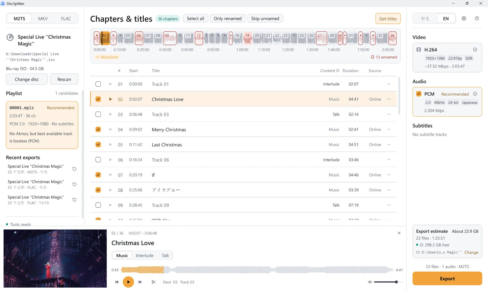
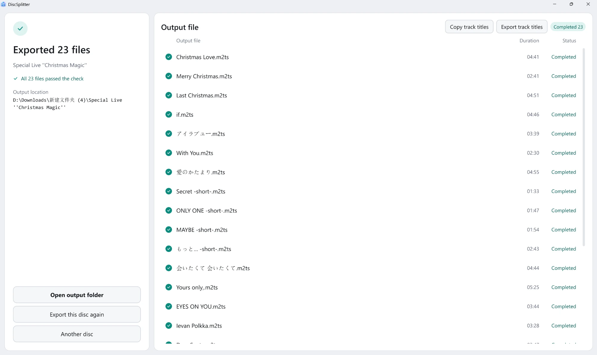
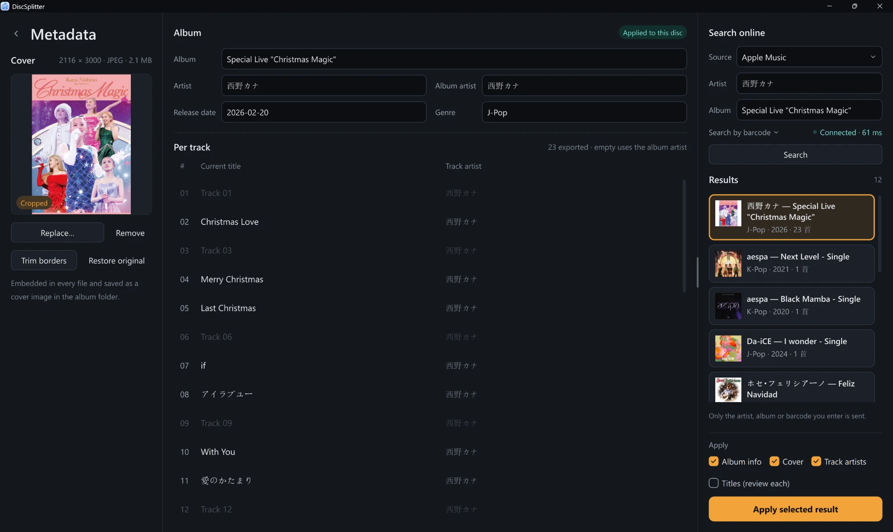

<div align="center">


<h1>DiscSplitter</h1>

**Split a concert Blu-ray, DVD or MKV at its chapters into one file per song, named from a setlist you review.**

<a href="https://github.com/StillDear/DiscSplitter/releases/latest"></a>

<sub>For unencrypted or already decrypted discs and files. DiscSplitter does not decrypt.</sub>

[How it works](#how-it-works) · [Features](#features) · [Install](#download-and-install) · [Help](#help-and-support) · [FAQ](#faq)

English | [简体中文](README.zh-CN.md)

  

</div>

<p align="center">
  <picture>
    <source media="(prefers-color-scheme: dark)" srcset="docs/images/en/workspace-dark.webp">
    
  </picture>
</p>

<br>

**DiscSplitter** is a free, open-source Windows app (MIT license) that splits a concert Blu-ray, DVD or MKV file by chapter into one file per song. It exports M2TS or MKV with the streams copied as they are, audio-only MKV, or tagged FLAC, and names the files from a setlist found on MusicBrainz, Apple Music, Deezer or Discogs, pasted, linked from a web page or read from a photo.

Many concert discs are one long programme with a chapter per song and chapter names that are empty or just numbers. DiscSplitter finds the main programme, fetches a setlist from the disc, an online database, a web page or a photo, proposes which song belongs to which chapter, and lets you check every match. Then it cuts one file per chapter you kept. **The split follows the chapters**: it does not recognise songs by listening to them, and a song without its own chapter needs a boundary you set.

<table>
<tr>
<td width="33%" valign="top">

### 🎧 Streams kept as they are

M2TS and MKV exports copy the picture, TrueHD Atmos, DTS-HD MA, LPCM and PGS subtitles without re-encoding them. The few exceptions are in the [FAQ](#faq).

</td>
<td width="33%" valign="top">

### 🏷️ Titles you confirm

MusicBrainz, Apple Music, Deezer, Discogs, a pasted list, a web page or a photo. Songs are lined up with chapters by length or in order, and nothing is applied until you review it.

</td>
<td width="33%" valign="top">

### 💿 Straight from the ISO

The installer's built-in engine reads Blu-ray ISO images and folders without mounting them. FFmpeg and MKVToolNix are included too.

</td>
</tr>
</table>

## How it works

| | You | DiscSplitter |
|:---:|---|---|
| **1** | Open a disc image, a `BDMV` / `VIDEO_TS` folder or an MKV | Scores the playlists and suggests the main programme, telling you why |
| **2** | Tick the chapters, audio and subtitles you want | Preselects the best audio track (lossless first) and suggests from the waveform which chapters are music, talk or interludes |
| **3** | Click **Get titles**, then review the matches | Finds a tracklist and proposes a title for each chapter; chapters it cannot match keep their current names until you edit them or leave them out |
| **4** | Pick M2TS, MKV or FLAC and export | Checks free space, writes one file per chapter into an album folder, then reads each file back |

<p align="center">
  
</p>
<p align="center"><sub>Reviewing titles from an online search. Matched, unmatched and removed chapters are counted at the top; each proposal is applied only after you confirm it.</sub></p>

<details>
<summary><b>More screenshots</b></summary>
<br>

<p align="center">
  
</p>
<p align="center"><sub>A finished M2TS export.</sub></p>

| | |
|:---:|:---:|
|  |  |
| Album info, cover and track artists | Export: extract, split, clean up, check |

</details>

## Features

#### Sources
- **Blu-ray:** ISO images and `BDMV` folders (no mounting), or a single `.mpls` playlist or `.m2ts` stream.
- **DVD:** ISO images and `VIDEO_TS` folders.
- **MKV:** files with chapters, or a whole folder of them.

#### Titles
- The disc's own chapter names, when it has them.
- Online search by artist, album or barcode: MusicBrainz, Apple Music, Deezer and Discogs.
- A setlist you paste, a web page you link (official site, Wikipedia, a shop), a `.txt`, `.cue`, `.nfo` or `.json` file, or a photo or screenshot. Photos are read by the OCR built into Windows, which only reads languages whose OCR support is installed in Windows (for example Japanese for a Japanese setlist).
- Matched by length or in order; you review every proposed title before it is applied.

#### Chapters and tracks
- Every audio track with codec, channels, sample rate and bit depth; you choose which to keep, and subtitles can be kept too.
- A waveform-based guess marks chapters as music, interlude or talk, so MCs are easy to leave out; you can change it.
- Merge, split at the playhead or move a boundary, with a built-in player.

#### Export
- **M2TS** straight from a Blu-ray, **MKV** with video, **MKV** audio only, or **FLAC** with tags and cover art (see [Choosing an output](#choosing-an-output)).
- Files named after the songs, one album folder per disc.
- Free space checked first; every finished file is read back and compared with the plan (what is checked is in the [FAQ](#faq)).
- An interrupted export resumes after the last finished file.

#### App
- Chinese and English; light, dark or system theme; adjustable interface and text size.
- Built-in help (<kbd>F1</kbd>) with a guide, tips, FAQ and troubleshooting.

<details>
<summary><b>How M2TS export works</b></summary>
<br>

Each chapter is cut from the disc by the built-in engine with the picture, the audio tracks you chose (TrueHD with its AC-3 core, DTS-HD with its extensions, LPCM) and PGS subtitles as the disc has them, a Dolby Vision enhancement layer included, and the disc's own timestamps.

Cuts are made at the disc's chapter marks, which normally sit on keyframes. The engine starts reading at the first chosen chapter instead of at the start of the disc, and chapters close together are cut in one pass. MKV from a Blu-ray is cut the same way; FLAC from a Blu-ray reads only the span the chosen chapters cover.

</details>

### Supported formats

| Source | M2TS | MKV (video) | MKV (audio only) | FLAC |
|---|:---:|:---:|:---:|:---:|
| Blu-ray (ISO, `BDMV`, `.mpls`, `.m2ts`) | ✓ | ✓ | ✓ | ✓ |
| DVD (ISO, `VIDEO_TS`) | | ✓ | ✓ | ✓ |
| MKV with chapters | | ✓ | ✓ | ✓ |

### Choosing an output

| Output | What you get | Pick it when |
|---|---|---|
| **M2TS** | Picture, chosen audio and subtitles exactly as on the Blu-ray, with the disc's timestamps. No title tag inside the file | You want each song as a piece of the original disc stream |
| **MKV (video)** | The same streams in Matroska, each file titled with its song | You want video files that most players and libraries handle well |
| **MKV (audio only)** | The chosen audio tracks in their original format, no picture | You want the original audio (e.g. TrueHD Atmos or several tracks) without the video |
| **FLAC** | One audio track per file, encoded losslessly, cut to the sample, with title, track number, album, artist and cover | You want a music library. From a lossy track (AC-3, DTS) FLAC keeps that decoded sound and cannot add quality back |

## Download and install

1. Download `DiscSplitter_<version>_Windows_x64_Setup.exe` from the [latest release](https://github.com/StillDear/DiscSplitter/releases/latest).
2. Run it. It installs for your user account without admin rights; the setup is in Chinese or English.
3. Start **DiscSplitter** from the Start menu and drop a disc onto the window.

| | |
|---|---|
| **System** | Windows 10 or 11, 64-bit |
| **Included** | Blu-ray engine (tsMuxeR), MKVToolNix, FFmpeg. Nothing else to install |
| **Updating** | Run the newer installer; it replaces the old version and keeps your settings |
| **Uninstalling** | Windows Settings → Apps. Settings and logs in `%USERPROFILE%\.disc_splitter` are left in place |

> [!IMPORTANT]
> The installer is not code-signed, so Windows SmartScreen may say it "protected your PC". Click **More info → Run anyway**. You can check the download against the SHA-256 listed in the release notes first:
> ```powershell
> Get-FileHash .\DiscSplitter_<version>_Windows_x64_Setup.exe
> ```

> [!NOTE]
> DiscSplitter is not a ripper. Encrypted discs have to be decrypted with another tool first.

## Help and support

- **In the app:** press <kbd>F1</kbd>, or click **?** at the top right. The help has a step-by-step guide, tips, answers to common questions and a troubleshooting page.
- **Something not working?** In **Help → Troubleshooting**, click **Copy diagnostics**, then **Report issue**, and paste them into the [issue](https://github.com/StillDear/DiscSplitter/issues) with what you did and what you saw. Diagnostics contain only the version, Windows version and tool status, no file paths.
- **What changed:** see the [releases](https://github.com/StillDear/DiscSplitter/releases).

## Privacy

DiscSplitter has no account, no telemetry and no update check. It only goes online when you ask it to:

- an online title search sends only the artist, album or barcode you typed, to the service you picked (MusicBrainz, Apple Music, Deezer or Discogs), and cover art comes from those services and the Cover Art Archive;
- a web page you link is fetched to read its setlist.

Everything else, including your discs, files and settings, stays on your computer.

## FAQ

<details>
<summary><b>How do I split a concert Blu-ray into individual songs?</b></summary>
<br>

Open the Blu-ray ISO or `BDMV` folder in DiscSplitter. It suggests the main playlist; keep the chapters that are songs, click **Get titles** to fetch the setlist and review the matches, then export M2TS, MKV or FLAC. Each chapter you kept becomes one file named after its song. A song that has no chapter of its own needs a boundary you set in the timeline.

</details>

<details>
<summary><b>Can I convert a Blu-ray concert to FLAC?</b></summary>
<br>

Yes. Choose **FLAC**: each song becomes one FLAC file with title, track number, album, artist and cover art, cut to the sample. From TrueHD, DTS-HD MA or LPCM the result is lossless. From a lossy track (AC-3, DTS) FLAC stores that decoded sound and cannot add quality back. To keep the original TrueHD or DTS-HD stream instead, choose **MKV (audio only)**.

</details>

<details>
<summary><b>How do I split an MKV file by chapters?</b></summary>
<br>

Open an MKV that has chapters (or a folder of them) and export MKV or FLAC; each chapter becomes one named file. Without the GUI, `split_now.py` splits an MKV by its chapters using names from a text file (see [docs/development.md](docs/development.md#command-line)).

</details>

<details>
<summary><b>Is DiscSplitter free? How is it different from MKVToolNix or tsMuxeR?</b></summary>
<br>

It is free and open source under the MIT license, with no account. It uses tsMuxeR, MKVToolNix and FFmpeg to do the cutting and adds what those tools leave to you: finding the main playlist, getting and matching the setlist, naming and tagging the files, and checking them after export.

</details>

<details>
<summary><b>Will the audio be re-encoded?</b></summary>
<br>

M2TS and MKV exports copy the picture and the audio as they are, with these exceptions:

- **FLAC output** decodes the chosen track and encodes it as FLAC. That is lossless, but the file is a new encode, not the disc's bitstream.
- **FLAC audio inside an MKV source** is decoded and encoded again as FLAC, because MKVToolNix cannot cut a FLAC track. The samples are the source's own; the compressed data is not identical.
- **LPCM from a DVD** is rewritten as plain PCM in the MKV. The samples are unchanged.

</details>

<details>
<summary><b>How exact are the cuts?</b></summary>
<br>

It depends on what the file holds:

- **With video**, a file has to start on a keyframe. A Blu-ray's chapter marks normally sit on keyframes, so cuts at the disc's own marks land on them; a file can run up to one picture group past its end. A boundary you move by hand snaps to a keyframe, usually less than a second away.
- **Audio-only MKV** is cut between compressed audio frames, so the edge can be off by up to one frame (a few milliseconds to a few tens of milliseconds, depending on the codec).
- **FLAC** is cut to the sample.

The check after export allows a margin on each file's length (2.5 s with video, 0.75 s audio-only, 0.25 s FLAC). That margin is how much the check tolerates, not how precise the cut is.

</details>

<details>
<summary><b>What does the check after export cover?</b></summary>
<br>

Each finished file is opened with ffprobe and compared with what the export planned: the file exists and can be read, its length is close to its chapter's, it has the expected number of video, audio and subtitle streams, a FLAC file really is FLAC, the title tag is set (M2TS has none), and, when there is video, the first sound starts within 0.25 s of the first picture.

Nothing is decoded, and the content is not compared bit for bit with the source, so the check does not prove that every frame plays or that sound stays in sync all the way through.

</details>

<details>
<summary><b>The online search found nothing. What now?</b></summary>
<br>

Smaller or regional releases are often missing. Try the album name alone or the barcode, paste the setlist from the concert's web page, link the page itself, or photograph the back cover and let the app read it (the language has to be available to Windows OCR). **Settings → Online metadata** has proxy and timeout options, and the search page can check the connection.

</details>

<details>
<summary><b>Why is there no M2TS option?</b></summary>
<br>

M2TS is offered only for Blu-ray sources. DVDs and MKV files export to MKV or FLAC.

</details>

<details>
<summary><b>Does it work on macOS or Linux?</b></summary>
<br>

Not yet. It is built and tested on Windows only.

</details>

## Limitations

- Encrypted discs are not supported; decrypt them first.
- Files are split at chapters. Songs are not detected from the sound, and a disc without per-song chapters needs boundaries set by hand.
- Cuts that keep the video land on keyframes (see [How exact are the cuts?](#faq)).
- Windows 10/11, 64-bit only.

## Build from source

Python 3.10+ on Windows:

```powershell
python -m venv .venv
.venv\Scripts\python.exe -m pip install -r requirements.txt
.venv\Scripts\python.exe app.py
```

`pip install` sets up the app itself, not the tools it drives. From source you also need:

- **FFmpeg** (`ffmpeg`, `ffprobe`) and **MKVToolNix** (`mkvmerge`, `mkvextract`, `mkvpropedit`) on your `PATH`, or set in **Settings → External tools**.
- **The Blu-ray engine**, built with `engine\build_engine.py` (needs Visual Studio 2022 or its Build Tools with the C++ workload). Without it, M2TS export is not offered, and Blu-rays are read through MKVToolNix instead (ISO images are then mounted by Windows).

Details, tests and packaging are in [docs/development.md](docs/development.md). Bug reports and suggestions are welcome as [issues](https://github.com/StillDear/DiscSplitter/issues).

## License and credits

DiscSplitter is released under the [MIT License](LICENSE).

- Blu-ray engine: [tsMuxeR](https://github.com/teaching-droid/tsMuxer), Apache License 2.0 ([license](engine/tsmuxer/LICENSE), [notice](engine/tsmuxer/NOTICE)), built with zlib.
- The installer also ships [MKVToolNix](https://mkvtoolnix.download/) and [FFmpeg](https://ffmpeg.org/) under their own licenses, installed with them in `tools\licenses`.
- Track data from [MusicBrainz](https://musicbrainz.org/), Apple Music, [Deezer](https://www.deezer.com/) and [Discogs](https://www.discogs.com/); covers also from the [Cover Art Archive](https://coverartarchive.org/).
- Built with the help of [Claude](https://claude.com/claude-code).
