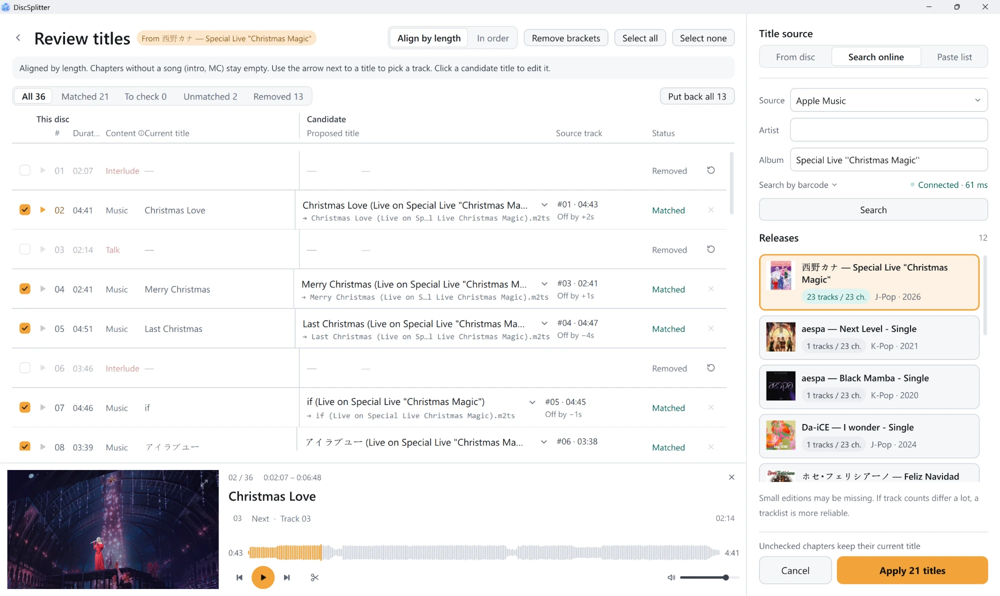
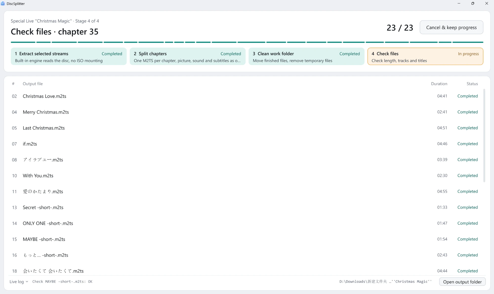

<div align="center">


<h1>DiscSplitter</h1>

**Split a concert Blu-ray, DVD or MKV into one lossless file per song, already named.**

<a href="https://github.com/StillDear/DiscSplitter/releases/latest"></a>

[How it works](#how-it-works) · [Features](#features) · [Install](#download-and-install) · [Help](#help-and-support) · [FAQ](#faq)

English | [简体中文](README.zh-CN.md)

  

</div>

<p align="center">
  <picture>
    <source media="(prefers-color-scheme: dark)" srcset="docs/images/en/workspace-dark.webp">
    
  </picture>
</p>

<br>

A concert disc is one long video with chapter marks and no song names. DiscSplitter opens the disc, finds the main title, gets the setlist from the disc, the web or a photo, lines the songs up with the chapters, and cuts one file per song. **Picture and sound are copied as they are; nothing is re-encoded unless you choose FLAC.**

<table>
<tr>
<td width="33%" valign="top">

### 🎧 Truly lossless

TrueHD Atmos, DTS-HD MA, LPCM and PGS subtitles are copied bit for bit. M2TS is cut straight from the disc at its own chapter marks.

</td>
<td width="33%" valign="top">

### 🏷️ Titles that match

MusicBrainz, Apple Music, Deezer, Discogs, a pasted list, a web page or a photo. Songs are matched to chapters by length, and you review every match.

</td>
<td width="33%" valign="top">

### 💿 Straight from the ISO

A built-in engine reads Blu-ray ISO images and folders without mounting them. One installer, nothing else to set up.

</td>
</tr>
</table>

## How it works

| | You | DiscSplitter |
|:---:|---|---|
| **1** | Open a disc image, a `BDMV` / `VIDEO_TS` folder or an MKV | Scores every playlist and picks the main feature, telling you why |
| **2** | Tick the chapters, audio and subtitles you want | Preselects the best lossless audio and marks which chapters are music, talk or interludes |
| **3** | Click **Get titles** | Finds a tracklist and lines it up with the chapters by length, for you to review |
| **4** | Pick M2TS, MKV or FLAC and export | Checks free space, writes one file per song into an album folder and verifies each one |

<p align="center">
  
  
</p>

<details>
<summary><b>More screenshots</b></summary>
<br>

| | |
|:---:|:---:|
|  |  |
| Album info, cover and track artists | Export: extract, split, clean up, check |

</details>

## Features

#### Sources
- **Blu-ray:** ISO images and `BDMV` folders (no mounting), or a single `.mpls` playlist or `.m2ts` stream.
- **DVD:** ISO images and `VIDEO_TS` folders.
- **MKV:** files with chapters, or a whole folder of them.

#### Titles
- The disc's own chapter names.
- Online search by artist, album or barcode: MusicBrainz, Apple Music, Deezer and Discogs.
- A setlist you paste, a web page you link (official site, Wikipedia, a shop), a photo or screenshot (read by the OCR built into Windows), or a `.txt`, `.cue`, `.nfo` or `.json` file.
- Matched by length or in order; every proposed title is checked by you before it is applied.

#### Chapters and tracks
- Every audio track with codec, channels, sample rate and bit depth; subtitles can be kept.
- The waveform marks each chapter as music, interlude or talk, so MCs are easy to leave out.
- Merge, split at the playhead or move a boundary, with a built-in player.

#### Export
- **M2TS** straight from a Blu-ray, **MKV** with video, **MKV** audio only, or **FLAC** with tags and cover art.
- Files named after the songs, one album folder per disc.
- Free space checked first; every file read back afterwards (length, streams, sound and picture in sync).
- Interrupted exports resume where they stopped.

#### App
- Chinese and English; light, dark or system theme; adjustable interface and text size.
- Built-in help (<kbd>F1</kbd>) with a guide, tips, FAQ and troubleshooting.

<details>
<summary><b>How M2TS export works</b></summary>
<br>

Each chapter is cut straight from the disc with the picture, every audio track (TrueHD with its AC-3 core, DTS-HD with its extensions, LPCM) and PGS subtitles exactly as the disc has them, a Dolby Vision enhancement layer included, and the disc's own timestamps, so sound and picture stay in step.

Cuts land on the disc's exact chapter marks (its 45 kHz ticks). The engine starts reading at the first chosen chapter rather than at the start of the disc, so a chapter near the end takes seconds, not minutes, and chapters close together are cut in one pass. MKV from a Blu-ray is cut the same way; FLAC from a Blu-ray reads only the span the chosen chapters cover.

</details>

### Supported formats

| Source | M2TS | MKV (video) | MKV (audio only) | FLAC |
|---|:---:|:---:|:---:|:---:|
| Blu-ray (ISO, `BDMV`, `.mpls`, `.m2ts`) | ✓ | ✓ | ✓ | ✓ |
| DVD (ISO, `VIDEO_TS`) | | ✓ | ✓ | ✓ |
| MKV with chapters | | ✓ | ✓ | ✓ |

## Download and install

1. Download `DiscSplitter_<version>_Windows_x64_Setup.exe` from the [latest release](https://github.com/StillDear/DiscSplitter/releases/latest).
2. Run it. It installs for your user account without admin rights; the setup is in Chinese or English.
3. Start **DiscSplitter** from the Start menu and drop a disc onto the window.

| | |
|---|---|
| **System** | Windows 10 or 11, 64-bit |
| **Included** | Blu-ray engine (tsMuxeR), MKVToolNix, FFmpeg. Nothing else to install |
| **Updating** | Run the newer installer; it replaces the old version and keeps your settings |
| **Uninstalling** | Windows Settings → Apps. Settings and logs in `%USERPROFILE%\.disc_splitter` are left in place |

> [!IMPORTANT]
> The installer is not code-signed, so Windows SmartScreen may say it "protected your PC". Click **More info → Run anyway**. You can check the download against the SHA-256 listed in the release notes first:
> ```powershell
> Get-FileHash .\DiscSplitter_1.0_Windows_x64_Setup.exe
> ```

> [!NOTE]
> DiscSplitter is not a ripper. Encrypted discs have to be decrypted with another tool first.

## Help and support

- **In the app:** press <kbd>F1</kbd>, or click **?** at the top right. The help has a step-by-step guide, tips, answers to common questions and a troubleshooting page.
- **Something not working?** In **Help → Troubleshooting**, click **Copy diagnostics**, then **Report issue**, and paste them into the [issue](https://github.com/StillDear/DiscSplitter/issues) with what you did and what you saw. Diagnostics contain only the version, Windows version and tool status, no file paths.
- **What changed:** see the [releases](https://github.com/StillDear/DiscSplitter/releases).

## Privacy

DiscSplitter has no account, no telemetry and no update check. It only goes online when you ask it to:

- an online title search sends only the artist, album or barcode you typed, to the service you picked (MusicBrainz, Apple Music, Deezer or Discogs), and cover art comes from those services and the Cover Art Archive;
- a web page you link is fetched to read its setlist.

Everything else, including your discs, files and settings, stays on your computer.

## FAQ

<details>
<summary><b>Will the audio be re-encoded?</b></summary>
<br>

No. M2TS and MKV exports copy every stream as it is. Only FLAC encodes, and FLAC is lossless.

</details>

<details>
<summary><b>Why does a file with video sometimes run slightly past the chapter?</b></summary>
<br>

Video can only be cut on a keyframe. A Blu-ray's own chapter marks sit on keyframes, so those cuts are exact (a file may run one picture group past its end). A boundary you move by hand snaps to the next keyframe, usually well under a second away. Audio-only exports cut exactly.

</details>

<details>
<summary><b>The online search found nothing. What now?</b></summary>
<br>

Smaller or regional releases are often missing. Try the album name alone or the barcode, paste the setlist from the concert's web page, link the page itself, or photograph the back cover and let the app read it. **Settings → Online metadata** has proxy and timeout options, and the search page can check the connection.

</details>

<details>
<summary><b>Why is there no M2TS option?</b></summary>
<br>

M2TS is offered only for Blu-ray sources. DVDs and MKV files export to MKV or FLAC.

</details>

<details>
<summary><b>Does it work on macOS or Linux?</b></summary>
<br>

Not yet. It is built and tested on Windows only.

</details>

## Limitations

- Encrypted discs are not supported; decrypt them first.
- Cuts that keep the video land on keyframes (see the [FAQ](#faq)).
- Windows 10/11, 64-bit only.

## Build from source

Python 3.10+ on Windows:

```powershell
python -m venv .venv
.venv\Scripts\python.exe -m pip install -r requirements.txt
.venv\Scripts\python.exe app.py
```

Building the Blu-ray engine, running the tests and making the installer are covered in [docs/development.md](docs/development.md). Bug reports and suggestions are welcome as [issues](https://github.com/StillDear/DiscSplitter/issues).

## License and credits

DiscSplitter is released under the [MIT License](LICENSE).

- Blu-ray engine: [tsMuxeR](https://github.com/teaching-droid/tsMuxer), Apache License 2.0 ([license](engine/tsmuxer/LICENSE), [notice](engine/tsmuxer/NOTICE)), built with zlib.
- The installer also ships [MKVToolNix](https://mkvtoolnix.download/) and [FFmpeg](https://ffmpeg.org/) under their own licenses, installed with them in `tools\licenses`.
- Track data from [MusicBrainz](https://musicbrainz.org/), Apple Music, [Deezer](https://www.deezer.com/) and [Discogs](https://www.discogs.com/); covers also from the [Cover Art Archive](https://coverartarchive.org/).
- Built with the help of [Claude](https://claude.com/claude-code).
