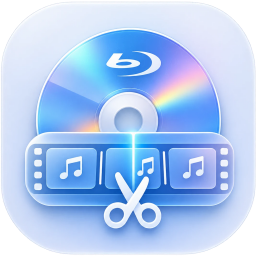

<div align="center">



# DiscSplitter

**Split a concert Blu-ray, DVD or MKV into one lossless file per song, already named.**

[**Download for Windows**](https://github.com/StillDear/DiscSplitter/releases/latest) &nbsp;·&nbsp; [How it works](#how-it-works) &nbsp;·&nbsp; [Features](#features) &nbsp;·&nbsp; [FAQ](#faq)

English &nbsp;|&nbsp; [简体中文](README.zh-CN.md)

  

</div>

<!--
  Hero screenshot. Add docs/images/workspace-light.png and workspace-dark.png
  (see docs/images/SHOTS.md), then remove this comment's start and end lines.

<p align="center">
  <picture>
    <source media="(prefers-color-scheme: dark)" srcset="docs/images/workspace-dark.png">
    
  </picture>
</p>
-->

A concert disc is one long video with chapter marks and no song names. DiscSplitter opens the disc, finds the main title, gets the setlist from the disc, the web or a photo, lines the songs up with the chapters, and cuts one file per song. Picture and sound are copied as they are, nothing is re-encoded unless you choose FLAC.

<table>
<tr>
<td width="33%" valign="top">

**Truly lossless**

TrueHD Atmos, DTS-HD MA, LPCM and PGS subtitles are copied bit for bit. M2TS is cut straight from the disc at its own chapter marks.

</td>
<td width="33%" valign="top">

**Titles that match**

Searches MusicBrainz, Apple Music, Deezer and Discogs, or reads a pasted list, a web page or a photo. Songs are matched to chapters by length, and you review every match.

</td>
<td width="33%" valign="top">

**Straight from the ISO**

A built-in tsMuxeR engine reads Blu-ray ISO images and folders without mounting them. One installer, no extra tools to set up.

</td>
</tr>
</table>

## How it works

| Step | What you do | What DiscSplitter does |
|:---:|---|---|
| **1** | Open a disc image, a `BDMV` / `VIDEO_TS` folder or an MKV | Scores every playlist and picks the main feature, telling you why |
| **2** | Tick the chapters, audio and subtitle tracks you want | Preselects the best lossless audio and guesses which chapters are music, talk or interludes |
| **3** | Click **Get titles** | Fetches a tracklist and lines it up with the chapters by length, for you to review |
| **4** | Pick M2TS, MKV or FLAC and export | Checks free space, cuts one file per song into an album folder and verifies each one |

<!--
  Step screenshots. Add docs/images/review.png and docs/images/done.png
  (see docs/images/SHOTS.md), then remove this comment's start and end lines.

<p align="center">
  
  
</p>
-->

## Features

**Sources**
- Blu-ray: ISO images and `BDMV` folders (no mounting), or a single `.mpls` playlist or `.m2ts` stream. Discs must be unencrypted.
- DVD: ISO images and `VIDEO_TS` folders.
- MKV files with chapters, or a whole folder of them.

**Titles**
- From the disc's own chapter names.
- Online search by artist, album or barcode: MusicBrainz, Apple Music, Deezer and Discogs (a free Discogs token adds covers).
- From a setlist you paste, a web page you link (official site, Wikipedia, a shop page), a photo or screenshot (read with the OCR built into Windows), or a `.txt`, `.cue`, `.nfo` or `.json` file.
- Matched to chapters by length or in order; every proposed title can be checked and changed before it is applied.

**Chapters and tracks**
- Every audio track on the playlist with codec, channels, sample rate and bit depth; subtitles can be kept.
- A waveform guess marks each chapter as music, interlude, talk or unsure, so MCs are easy to leave out.
- Merge chapters, split at the playhead or move a boundary, with a built-in player and waveform.

**Export**
- **M2TS** straight from a Blu-ray, **MKV** with video, **MKV** audio only, or **FLAC** with tags and cover art.
- Files are named after the songs and each disc gets its own album folder.
- Free space is checked first; every file is read back afterwards (length, streams, audio and video in sync).
- Interrupted exports resume where they stopped.

**App**
- English and Chinese interface; light, dark or system theme.

<details>
<summary><b>How M2TS export works</b></summary>
<br>

Each chapter is cut straight from the disc with the picture, every audio track (TrueHD with its AC-3 core, DTS-HD with its extensions, LPCM) and PGS subtitles exactly as the disc has them, a Dolby Vision enhancement layer included, and the disc's own timestamps, so sound and picture stay in step.

Cuts land on the disc's exact chapter marks (its 45 kHz ticks). The engine starts reading at the first chosen chapter rather than at the start of the disc, so a chapter near the end takes seconds, not minutes, and chapters close together are cut in one pass. MKV from a Blu-ray is cut the same way; FLAC from a Blu-ray reads only the span the chosen chapters cover.

</details>

### Supported formats

| Source | M2TS | MKV (video) | MKV (audio only) | FLAC |
|---|:---:|:---:|:---:|:---:|
| Blu-ray (ISO, `BDMV`, `.mpls`, `.m2ts`) | ✓ | ✓ | ✓ | ✓ |
| DVD (ISO, `VIDEO_TS`) | | ✓ | ✓ | ✓ |
| MKV with chapters | | ✓ | ✓ | ✓ |

## Download and install

1. Download `DiscSplitter-Setup-<version>.exe` from the [latest release](https://github.com/StillDear/DiscSplitter/releases/latest).
2. Run it and follow the installer.
3. Start **DiscSplitter** from the Start menu and open a disc.

| | |
|---|---|
| **System** | Windows 10 or 11, 64-bit |
| **Included** | Blu-ray engine (tsMuxeR), MKVToolNix, ffmpeg. Nothing else to install |
| **Settings and logs** | `%USERPROFILE%\.disc_splitter` |

> [!NOTE]
> DiscSplitter is not a ripper. Encrypted discs have to be decrypted with another tool first.

## FAQ

<details>
<summary><b>Will the audio be re-encoded?</b></summary>
<br>

No. M2TS and MKV exports copy every stream as it is. Only FLAC encodes, and FLAC is lossless.

</details>

<details>
<summary><b>Why does a cut with video sometimes run slightly past the chapter?</b></summary>
<br>

Video can only be cut on a keyframe. A Blu-ray's own chapter marks sit on keyframes, so those cuts are exact (a file may run one picture group past its end). A boundary you move by hand snaps to the next keyframe, usually well under a second away. Audio-only exports cut exactly.

</details>

<details>
<summary><b>The online search found nothing. What now?</b></summary>
<br>

Smaller or regional releases are often missing. Paste the setlist from the concert's web page, link the page itself, or take a screenshot of the back cover and let the app read it. **Settings → Online metadata** has proxy and timeout options, and the search page can check the connection.

</details>

<details>
<summary><b>Does it work on macOS or Linux?</b></summary>
<br>

Not yet. It is built and tested on Windows only.

</details>

## Limitations

- Encrypted discs are not supported; decrypt them first.
- Cuts that keep the video land on keyframes (see the [FAQ](#faq)).
- Windows only.

## Build from source

Python 3.10+ on Windows:

```powershell
python -m venv .venv
.venv\Scripts\python.exe -m pip install -r requirements.txt
.venv\Scripts\python.exe app.py
```

Building the Blu-ray engine, running the tests and making the installer are covered in [docs/development.md](docs/development.md).

## License and credits

DiscSplitter is released under the [MIT License](LICENSE).

- Blu-ray engine: [tsMuxeR](https://github.com/teaching-droid/tsMuxer), Apache License 2.0 ([license](engine/tsmuxer/LICENSE), [notice](engine/tsmuxer/NOTICE)), built with zlib.
- The installer also ships [MKVToolNix](https://mkvtoolnix.download/) and [ffmpeg](https://ffmpeg.org/) under their own licenses, installed with them in `tools\licenses`.
- Track data from [MusicBrainz](https://musicbrainz.org/), Apple Music, [Deezer](https://www.deezer.com/) and [Discogs](https://www.discogs.com/).
