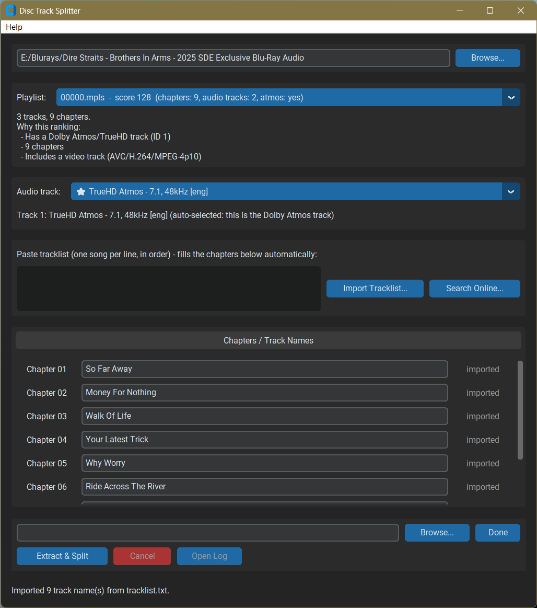

# DiscSplitter

**Losslessly split Blu-ray, DVD and MKV chapters into named audio or video tracks, with titles matched for you.**

把蓝光、DVD、MKV 按章节无损拆成带曲名的音频或视频，曲名自动对上章节。蓝光由内置的 tsMuxeR 引擎直接读取（ISO 无需挂载），并可按章节原样切成 M2TS。

<p align="center">
  
</p>

A Windows desktop app (PySide6 / Qt Quick). Open a disc or an MKV, pick the chapters, audio and subtitle tracks you want, get the titles in, and export one file per chapter. Nothing is re-encoded unless you ask for FLAC.

Blu-rays are handled by a built-in engine: [tsMuxeR](https://github.com/teaching-droid/tsMuxer), compiled from source in `engine/` and shipped with the app. It reads Blu-ray folders and ISO images directly (no mounting), finds the main title, and cuts chapters into M2TS straight from the disc.

## Features

- **Sources:** unencrypted Blu-ray ISOs and `BDMV` folders (read by the built-in engine without mounting), a single `.mpls` playlist or `.m2ts` stream, DVD ISOs and `VIDEO_TS` folders, MKV files with chapters, or a folder of MKVs. Playlists are scored and the main feature is picked for you (the engine marks the title that plays the most footage), with the reasons shown.
- **Tracks:** every audio track the playlist has (Atmos, TrueHD, DTS-HD MA, LPCM, ...) with codec, channels, sample rate and bit depth; the best lossless one is preselected. Subtitles can be kept too.
- **Titles:** from the disc's own chapter names, a pasted or photographed tracklist (OCR), an imported file (`.txt`, `.cue`, `.json`, `.nfo`), or an online search (MusicBrainz, Discogs) by title or barcode. Titles are matched to chapters by length, and every match can be checked and changed on a review page before it is applied.
- **Content guess:** from the waveform, each chapter is marked as music, interlude, talk or unsure, so MCs and interludes can be taken out of the list. It is a guess and can be changed by hand.
- **Chapters:** merge, split at the playhead, or move a boundary; a built-in preview player with waveform shows where you are.
- **Export:** MKV with video, MKV audio-only, M2TS straight from a Blu-ray, or FLAC with tags and cover art. Files are named after the titles, each disc goes into its own album folder, free space is checked first, and every file is read back and verified afterwards (length, streams, and that sound and picture start together).
- **M2TS (Blu-ray):** each chapter is cut straight from the disc with the picture, every audio track (TrueHD with its AC-3 core, DTS-HD with its extensions, LPCM) and PGS subtitles exactly as the disc has them, a Dolby Vision enhancement layer included, and the disc's own timestamps, so sound and picture stay in step as on the disc. Chapters that follow one another are cut in one pass. FLAC from a Blu-ray reads only the span the chosen chapters cover.
- **Resumable:** progress is saved as it goes; a cancelled or crashed export picks up where it stopped.
- Chinese and English interface; dark, light or system theme.

## Install

Download `DiscSplitter-Setup-<version>.exe` from the releases page and run it. The installer includes everything the app needs, the Blu-ray engine, MKVToolNix and ffmpeg among them, so nothing else has to be installed.

## Run from source

Python 3.10 or newer on Windows:

```powershell
python -m venv .venv
.venv\Scripts\python.exe -m pip install -r requirements.txt
.venv\Scripts\python.exe engine\build_engine.py
.venv\Scripts\python.exe app.py
```

`engine\build_engine.py` compiles the Blu-ray engine into `engine\bin\tsMuxeR.exe`; it needs Visual Studio 2022 or its Build Tools with the C++ workload (see [engine/UPSTREAM.md](engine/UPSTREAM.md)). Without it Blu-rays are read with MKVToolNix as before, and M2TS export is not offered.

Running from source uses ffmpeg (`ffmpeg`, `ffprobe`) and MKVToolNix (`mkvmerge`, `mkvextract`, `mkvpropedit`, all three from the same folder) from your `PATH`, or from paths set in the app (Settings → External tools). With the engine built, MKVToolNix is only needed for MKV output and MKV sources. DVD sources need an ffmpeg build with `dvdvideo` support.

Settings, logs and caches are kept in `%USERPROFILE%\.disc_splitter`.

## Development

```powershell
.venv\Scripts\python.exe -m pip install -r requirements-dev.txt
.venv\Scripts\python.exe -m pytest -q
$env:QT_QPA_PLATFORM = "offscreen"
.venv\Scripts\python.exe app.py --smoke-test
```

The smoke test runs every screen with fake disc data in both languages and all themes, and fails on any Qt/QML warning. `--smoke-screenshots <folder>` also saves an image of each screen. Tests marked `engine` build a small Blu-ray with ffmpeg and the engine and export it end to end; they are skipped while the engine is not built.

Build the installer (needs Inno Setup 6; writes `dist\DiscSplitter-Setup-<version>.exe`):

```powershell
packaging\build_installer.bat
```

`build_exe.bat` builds a single portable `DiscSplitter.exe` instead (same `packaging/installer.spec`, one-file mode); that one includes the Blu-ray engine but not MKVToolNix or ffmpeg.

| Path | What is there |
|---|---|
| `app.py` | Entry point |
| `gui/` | The bridge between Python and QML: backend, controllers (`disc`, `preview`, `names`, `metadata`, `exporter`), models, texts |
| `qml/` | Screens and components |
| `core/` | Everything without a GUI: sources, tracklists and pasted set lists, online lookups, OCR, previews, naming, tags, splitting, checks, the export pipeline (layers are listed in `core/__init__.py`); `core/engine.py` drives the Blu-ray engine |
| `engine/` | The Blu-ray engine: tsMuxeR source snapshot, zlib, its CMake build and `build_engine.py` ([UPSTREAM.md](engine/UPSTREAM.md)) |
| `split_now.py` | Command-line splitter for an MKV that has chapters |
| `packaging/` | Installer build |
| `tests/` | Unit, integration and smoke tests |

## Limitations

- Not a ripper: encrypted discs have to be decrypted first.
- Cuts with video kept land on a keyframe. A Blu-ray's own chapter marks sit on keyframes, so those cuts are exact (a file may run one picture group past its end); a chapter boundary moved by hand moves to the next keyframe, usually well under a second away. Audio-only exports cut exactly.
- Built and tested on Windows only.

## License

MIT, see [LICENSE](LICENSE). The Blu-ray engine in `engine/tsmuxer` is tsMuxeR under the Apache License 2.0 ([LICENSE](engine/tsmuxer/LICENSE), [NOTICE](engine/tsmuxer/NOTICE)), built with zlib (zlib licence). The installer bundles third-party tools (tsMuxeR, MKVToolNix, ffmpeg) under their own licenses, which are installed next to them in `tools\licenses`.
