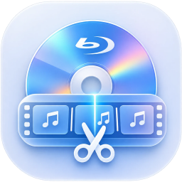
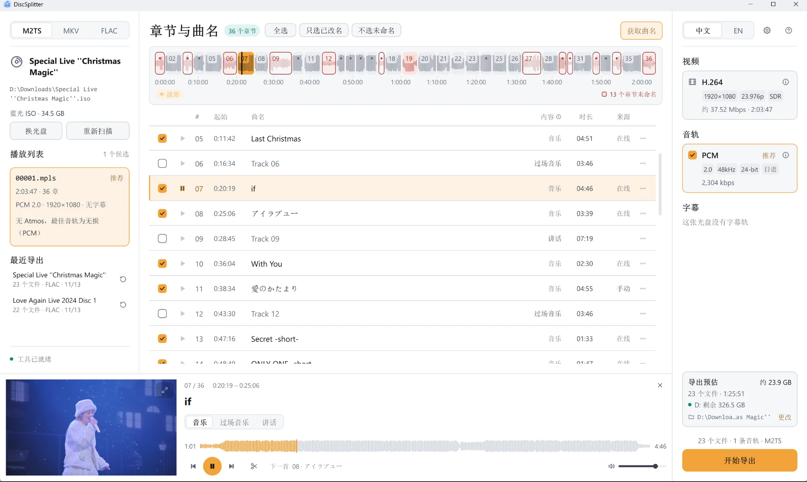
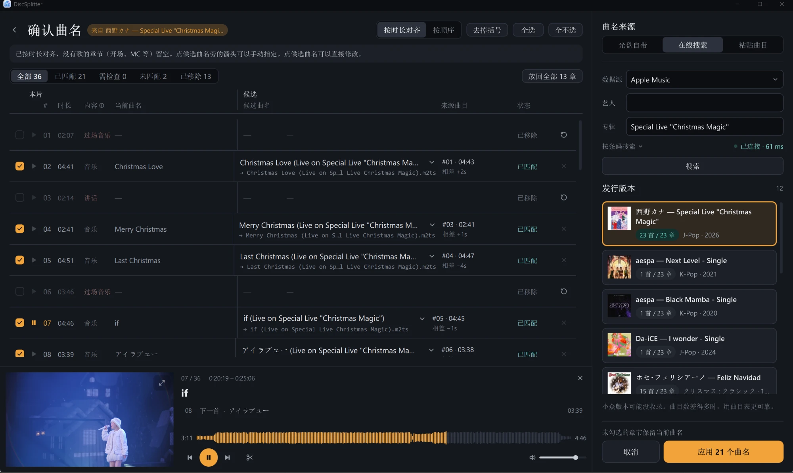
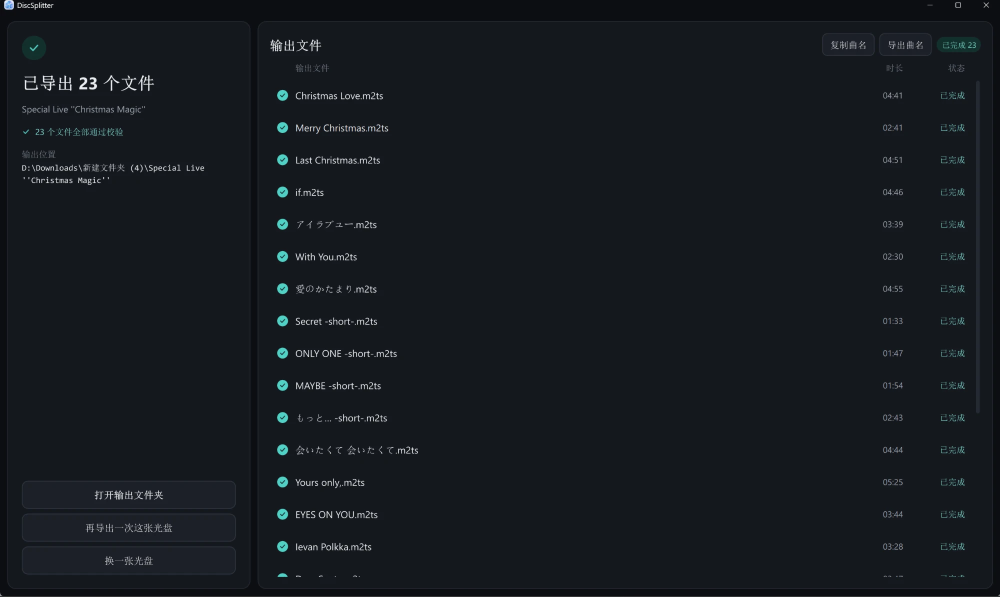
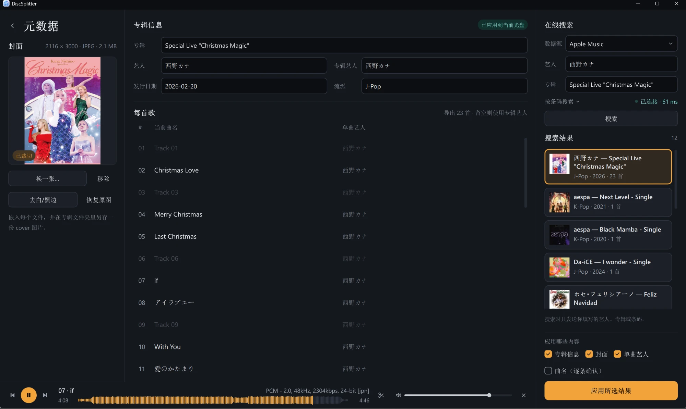
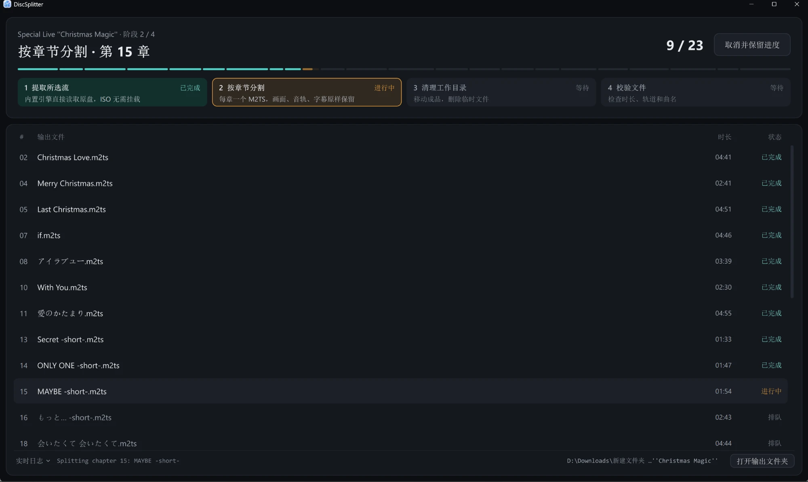

<div align="center">



<h1>DiscSplitter</h1>

**把演唱会蓝光、DVD 或 MKV 按章节拆成一首歌一个文件，曲名来自你核对过的歌单。**

<a href="https://github.com/StillDear/DiscSplitter/releases/latest"></a>

<sub>适用于未加密或已解密的光盘和文件。DiscSplitter 不做解密。</sub>

[使用流程](#使用流程) · [功能](#功能) · [安装](#下载安装) · [帮助](#帮助与支持) · [常见问题](#常见问题)

[English](README.md) | 简体中文

  

</div>

<p align="center">
  <picture>
    <source media="(prefers-color-scheme: dark)" srcset="docs/images/zh/workspace-dark.webp">
    
  </picture>
</p>

<br>

**DiscSplitter** 是一个免费、开源的 Windows 软件（MIT 许可证），用来把演唱会蓝光、DVD 或 MKV 文件按章节拆成一首歌一个文件。可以导出原样复制各条流的 M2TS 或 MKV、仅音频的 MKV，或带标签的 FLAC；文件名来自歌单，歌单可以从 MusicBrainz、Apple Music、Deezer、Discogs 搜索，也可以粘贴、填网页链接或从照片里识别。

很多演唱会光盘是一整段正片，每首歌一个章节，章节名却是空的或者只有编号。DiscSplitter 会找出正片，从光盘、在线数据库、网页或一张照片里拿到歌单，提出每个章节对应哪首歌，由你逐条核对，再把你保留的章节一个章节切成一个文件。**拆分依据是章节**：它不会靠听声音识别歌曲，没有单独章节的歌需要你自己定分界。

<table>
<tr>
<td width="33%" valign="top">

### 🎧 流原样保留

导出 M2TS 和 MKV 时，画面、TrueHD Atmos、DTS-HD MA、LPCM 和 PGS 字幕都不重新编码。少数例外见[常见问题](#常见问题)。

</td>
<td width="33%" valign="top">

### 🏷️ 曲名由你确认

MusicBrainz、Apple Music、Deezer、Discogs，或者粘贴的歌单、网页、照片都行。按时长或按顺序把歌曲对到章节上，你核对之前不会应用。

</td>
<td width="33%" valign="top">

### 💿 ISO 直接读

安装包里的内置引擎直接读取蓝光 ISO 和文件夹，不用挂载。FFmpeg 和 MKVToolNix 也已包含。

</td>
</tr>
</table>

## 使用流程

| | 你要做的 | DiscSplitter 做的 |
|:---:|---|---|
| **1** | 打开光盘镜像、`BDMV` / `VIDEO_TS` 文件夹或 MKV | 给播放列表打分，推荐正片，并说明理由 |
| **2** | 勾选要的章节、音轨和字幕 | 默认选好最好的音轨（无损优先），并根据波形推测每个章节是音乐、说话还是过场 |
| **3** | 点 **获取曲名**，核对匹配结果 | 找到歌单，给每个章节提出曲名；对不上的章节保留原来的名字，等你修改或去掉 |
| **4** | 选 M2TS、MKV 或 FLAC，导出 | 先检查剩余空间，再一个章节一个文件写进专辑文件夹，最后逐个读回检查 |

<p align="center">
  
</p>
<p align="center"><sub>核对在线搜索得到的曲名。顶部统计已匹配、未匹配和已移除的章节；每条候选都要你确认后才会应用。</sub></p>

<details>
<summary><b>更多截图</b></summary>
<br>

<p align="center">
  
</p>
<p align="center"><sub>一次完成的 M2TS 导出。</sub></p>

| | |
|:---:|:---:|
|  |  |
| 专辑信息、封面和单曲艺人 | 导出：提取、分割、清理、校验 |

</details>

## 功能

#### 来源
- **蓝光：** ISO 镜像和 `BDMV` 文件夹（不用挂载），也可以只打开一个 `.mpls` 播放列表或 `.m2ts` 流。
- **DVD：** ISO 镜像和 `VIDEO_TS` 文件夹。
- **MKV：** 带章节的文件，或者一整个文件夹。

#### 曲名
- 光盘自带的章节名（如果有）。
- 按艺人、专辑或条码在线搜索：MusicBrainz、Apple Music、Deezer、Discogs。
- 你手上已有的音乐文件（CD 抓轨、录音室专辑）：在本机读取其中的标签，取得专辑信息、封面、单曲艺人和曲名。整张专辑只有一个文件时，按它的 CUE 分成单曲。
- 粘贴的歌单、网页链接（官网、维基百科、商店页）、`.txt`、`.cue`、`.nfo`、`.json` 文件，或者照片、截图。照片用 Windows 自带的文字识别读取，只能识别 Windows 里已安装识别支持的语言（例如日文歌单需要日文）。
- 按时长或按顺序对齐；每个候选曲名都由你核对后才会应用。

#### 章节与音轨
- 列出全部音轨，带编码、声道、采样率和位深，由你选择保留哪些；也可以保留字幕。
- 根据波形推测每个章节是音乐、过场还是说话，方便去掉 MC；推测结果可以改。
- 合并章节、在播放位置拆分、挪动分界，配有内置播放器。

#### 导出
- 从蓝光直接切 **M2TS**，带视频的 **MKV**，只有音频的 **MKV**，或带标签和封面的 **FLAC**（见[怎么选输出格式](#怎么选输出格式)）。
- 文件按曲名命名，每张盘一个专辑文件夹。
- 导出前检查剩余空间；导出后逐个读回文件，和计划对比（检查范围见[常见问题](#常见问题)）。
- 导出中断后，从最后一个完成的文件之后继续。

#### 软件
- 中文和英文；浅色、深色或跟随系统；可调界面缩放和字体大小。
- 内置帮助（<kbd>F1</kbd>）：使用指南、技巧、常见问题和问题排查。

<details>
<summary><b>M2TS 导出是怎么做的</b></summary>
<br>

每个章节由内置引擎直接从光盘上切出，画面、你选的音轨（TrueHD 连同 AC-3 内核、DTS-HD 连同扩展、LPCM）和 PGS 字幕都保持盘上的样子，杜比视界增强层也在，时间戳沿用光盘自己的。

切点在光盘的章节点上，这些章节点通常就在关键帧上。引擎从第一个选中的章节开始读，而不是从盘头读起，相邻的章节一次切出。从蓝光导出 MKV 用的是同样的方式；从蓝光导出 FLAC 时，只读选中章节覆盖的那一段。

</details>

### 支持的格式

| 来源 | M2TS | MKV（带视频） | MKV（仅音频） | FLAC |
|---|:---:|:---:|:---:|:---:|
| 蓝光（ISO、`BDMV`、`.mpls`、`.m2ts`） | ✓ | ✓ | ✓ | ✓ |
| DVD（ISO、`VIDEO_TS`） | | ✓ | ✓ | ✓ |
| 带章节的 MKV | | ✓ | ✓ | ✓ |

### 怎么选输出格式

| 输出 | 得到什么 | 适合什么时候 |
|---|---|---|
| **M2TS** | 画面、选中的音轨和字幕都和蓝光上一样，沿用光盘的时间戳；文件里没有曲名标签 | 想让每首歌保持原盘流的一段 |
| **MKV（带视频）** | 同样的流放进 Matroska，每个文件写入曲名 | 想要大多数播放器和媒体库都好用的视频文件 |
| **MKV（仅音频）** | 选中的音轨保持原来的格式，不带画面 | 想保留原始音频（例如 TrueHD Atmos 或多条音轨），不要视频 |
| **FLAC** | 每个文件一条音轨，无损编码、精确到采样，写入曲名、曲号、专辑、艺人和封面 | 想建音乐库。来源是有损音轨（AC-3、DTS）时，FLAC 只是保存解码后的声音，不会提升音质 |

## 下载安装

1. 从 [最新版本](https://github.com/StillDear/DiscSplitter/releases/latest) 下载 `DiscSplitter_<版本号>_Windows_x64_Setup.exe`。
2. 运行安装包。默认只为当前用户安装，不需要管理员权限；安装界面有中文和英文。
3. 从开始菜单打开 **DiscSplitter**，把光盘拖进窗口。

| | |
|---|---|
| **系统** | Windows 10 或 11，64 位 |
| **已包含** | 蓝光引擎（tsMuxeR）、MKVToolNix、FFmpeg，不用另外安装 |
| **升级** | 直接运行新版安装包，会替换旧版本并保留设置 |
| **卸载** | Windows 设置 → 应用。`%USERPROFILE%\.disc_splitter` 里的设置和日志会保留 |

> [!IMPORTANT]
> 安装包没有代码签名，Windows SmartScreen 可能会提示“Windows 已保护你的电脑”。点 **更多信息 → 仍要运行** 即可。安装前可以先核对文件，和发布说明里的 SHA-256 比较：
> ```powershell
> Get-FileHash .\DiscSplitter_<版本号>_Windows_x64_Setup.exe
> ```

> [!NOTE]
> DiscSplitter 不是抓轨/解密工具。加密的光盘要先用别的工具解密。

## 帮助与支持

- **软件里：** 按 <kbd>F1</kbd>，或点右上角的 **?**。帮助里有分步指南、使用技巧、常见问题和问题排查。
- **遇到问题：** 在 **帮助 → 问题排查与反馈** 里点 **复制诊断信息**，再点 **报告问题**，把诊断信息粘贴进 [Issue](https://github.com/StillDear/DiscSplitter/issues)，写清楚做了什么、看到了什么。诊断信息只有版本号、系统版本和工具状态，不含文件路径。
- **更新内容：** 见 [Releases](https://github.com/StillDear/DiscSplitter/releases)。

## 隐私

DiscSplitter 不需要账号，没有任何统计上报，也不检查更新。只有你主动操作时才会联网：

- 在线搜索曲名时，只把你填的艺人、专辑或条码发给你选的服务（MusicBrainz、Apple Music、Deezer 或 Discogs），封面来自这些服务和 Cover Art Archive；
- 你填了网页链接时，会读取那个网页里的歌单。

除此之外，光盘、文件和设置都只留在你的电脑上。

## 常见问题

<details>
<summary><b>怎么把演唱会蓝光拆成一首首单曲？</b></summary>
<br>

在 DiscSplitter 里打开蓝光 ISO 或 `BDMV` 文件夹，它会推荐正片的播放列表。勾选是歌曲的章节，点 **获取曲名** 拿到歌单并核对匹配结果，再导出 M2TS、MKV 或 FLAC。每个保留的章节都会成为一个以曲名命名的文件。没有单独章节的歌，需要你在时间轴上设分界。

</details>

<details>
<summary><b>能把蓝光演唱会转成 FLAC 吗？</b></summary>
<br>

能。选 **FLAC**：每首歌一个 FLAC 文件，写入曲名、曲号、专辑、艺人和封面，精确到采样。来源是 TrueHD、DTS-HD MA 或 LPCM 时结果是无损的；来源是有损音轨（AC-3、DTS）时，FLAC 只是保存解码后的声音，不会提升音质。想保留原始的 TrueHD 或 DTS-HD 码流，就选 **MKV（仅音频）**。

</details>

<details>
<summary><b>怎么把 MKV 按章节拆分？</b></summary>
<br>

打开带章节的 MKV（或一整个文件夹），导出 MKV 或 FLAC，每个章节成为一个带曲名的文件。不打开界面的话，`split_now.py` 可以按章节拆分 MKV，曲名从文本文件读取（见 [docs/development.zh-CN.md](docs/development.zh-CN.md#命令行)）。

</details>

<details>
<summary><b>DiscSplitter 免费吗？和 MKVToolNix、tsMuxeR 有什么不同？</b></summary>
<br>

免费、开源，MIT 许可证，不需要账号。切割由 tsMuxeR、MKVToolNix 和 FFmpeg 完成；DiscSplitter 补上这些工具留给你自己做的部分：找到正片播放列表、获取并匹配歌单、给文件命名和写标签，以及导出后的检查。

</details>

<details>
<summary><b>音频会被重新编码吗？</b></summary>
<br>

导出 M2TS 和 MKV 时，画面和音频都原样复制，只有这几种例外：

- **导出 FLAC** 会解码选中的音轨，再编码成 FLAC。这是无损的，但文件是新编码的，不是光盘上的原始码流。
- **MKV 来源里的 FLAC 音轨** 会解码后重新编码成 FLAC，因为 MKVToolNix 不能切 FLAC 音轨。采样就是原来的采样，但压缩后的数据和原文件不完全相同。
- **DVD 的 LPCM** 在 MKV 里改写成普通 PCM，采样不变。

</details>

<details>
<summary><b>切点有多精确？</b></summary>
<br>

要看文件里有什么：

- **带视频时**，文件必须从关键帧开始。蓝光的章节点通常就在关键帧上，所以按光盘自己的章节点切，切点就落在章节点上；文件末尾可能多出最多一个画面组。手动挪过的分界会对齐到关键帧，通常不到一秒。
- **仅音频的 MKV** 在压缩音频帧之间切，边缘最多差一帧（视编码不同，几毫秒到几十毫秒）。
- **FLAC** 精确到采样。

导出后的检查对每个文件的时长留有余量（带视频 2.5 秒，仅音频 0.75 秒，FLAC 0.25 秒）。这是检查能容忍的范围，不是切割精度。

</details>

<details>
<summary><b>导出后的检查查了什么？</b></summary>
<br>

每个完成的文件都会用 ffprobe 打开，和导出计划对比：文件存在且能读取；时长和章节接近；视频、音频、字幕流的数量符合预期；FLAC 文件确实是 FLAC；曲名标签已写入（M2TS 没有标签）；带视频时，第一段声音和第一帧画面的起点相差不超过 0.25 秒。

检查不解码，也不和来源逐字节比对，所以不能证明每一帧都能播放，也不能证明全程音画同步。

</details>

<details>
<summary><b>在线搜索什么都没找到怎么办？</b></summary>
<br>

小众或地区性的版本经常查不到。可以只填专辑名或改用条码，从演唱会的网页上复制歌单粘贴进来，或者直接填网页链接，也可以给封底拍张照让软件识别（对应语言要在 Windows 文字识别里可用）。**设置 → 在线元数据** 里可以设置代理和超时，搜索页上也能检查网络连接。

</details>

<details>
<summary><b>为什么没有 M2TS 选项？</b></summary>
<br>

M2TS 只在蓝光来源时提供。DVD 和 MKV 来源可以导出 MKV 或 FLAC。

</details>

<details>
<summary><b>支持 macOS 或 Linux 吗？</b></summary>
<br>

暂时不支持，目前只在 Windows 上开发和测试。

</details>

## 局限

- 不支持加密光盘，需要先解密。
- 按章节拆分，不会从声音里识别歌曲；没有逐首章节的光盘需要手动设分界。
- 保留视频时切点落在关键帧上（见[常见问题](#常见问题)里的“切点有多精确？”）。
- 仅支持 Windows 10/11 64 位。

## 从源码运行

Windows 上需要 Python 3.10 或更高版本：

```powershell
python -m venv .venv
.venv\Scripts\python.exe -m pip install -r requirements.txt
.venv\Scripts\python.exe app.py
```

`pip install` 只装好软件本身，不包括它调用的工具。从源码运行还需要：

- **FFmpeg**（`ffmpeg`、`ffprobe`）和 **MKVToolNix**（`mkvmerge`、`mkvextract`、`mkvpropedit`），放在 `PATH` 里，或在 **设置 → 外部工具** 里指定。
- **蓝光引擎**，用 `engine\build_engine.py` 编译（需要 Visual Studio 2022 或它的生成工具，并装好 C++ 工作负载）。没有引擎时不提供 M2TS 导出，蓝光改用 MKVToolNix 读取（ISO 镜像这时由 Windows 挂载）。

详细说明、测试和打包见 [docs/development.zh-CN.md](docs/development.zh-CN.md)。欢迎通过 [Issue](https://github.com/StillDear/DiscSplitter/issues) 报告问题或提出建议。

## 许可证与致谢

DiscSplitter 以 [MIT 许可证](LICENSE) 发布。

- 蓝光引擎：[tsMuxeR](https://github.com/teaching-droid/tsMuxer)，Apache License 2.0（[许可证](engine/tsmuxer/LICENSE)、[NOTICE](engine/tsmuxer/NOTICE)），用 zlib 编译。
- 安装包还附带了 [MKVToolNix](https://mkvtoolnix.download/) 和 [FFmpeg](https://ffmpeg.org/)，它们各自的许可证随程序装在 `tools\licenses` 里。
- 曲目数据来自 [MusicBrainz](https://musicbrainz.org/)、Apple Music、[Deezer](https://www.deezer.com/) 和 [Discogs](https://www.discogs.com/)；封面也来自 [Cover Art Archive](https://coverartarchive.org/)。
- 开发过程中得到了 [Claude](https://claude.com/claude-code) 的协助。
